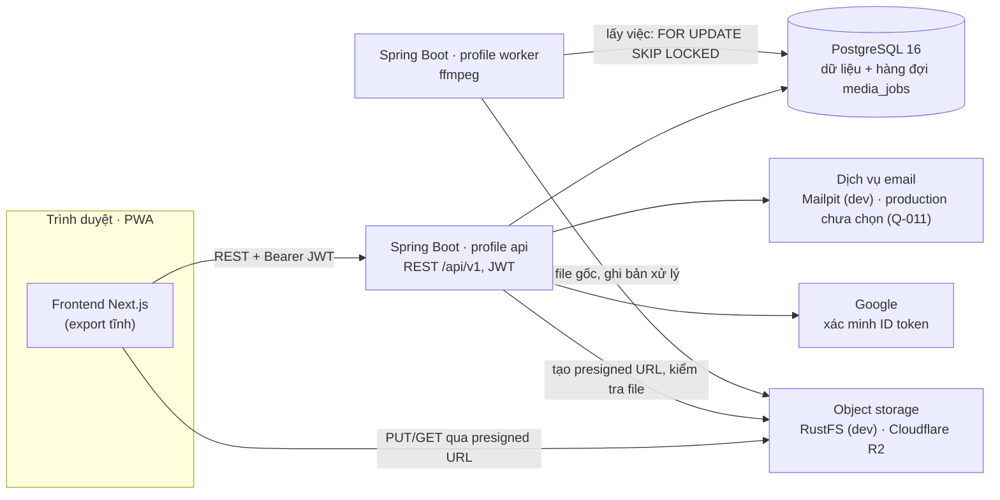
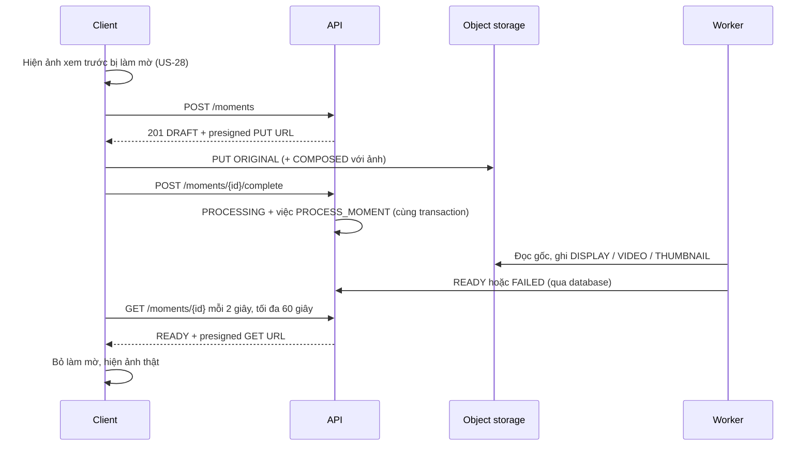

# Kiến trúc · Khoảnh khắc (moment)

Cập nhật: 17/11/2026 · Phạm vi: giai đoạn 1 (MVP) và hướng mở rộng · Liên quan: [Kế hoạch tổng quan](docs/00-tong-quan/ke-hoach-tong-quan.md), [Đặc tả MVP](docs/01-san-pham/dac-ta-mvp.md), [Thiết kế database](docs/02-ky-thuat/thiet-ke-database.md), [Danh sách API](docs/02-ky-thuat/danh-sach-api.md), [ADR](docs/04-quyet-dinh/README.md)

File này mô tả hệ thống được chia thành những phần nào, mỗi phần làm gì và các phần nói chuyện với nhau ra sao. Hành vi chi tiết (quy tắc nghiệp vụ, bảng, endpoint) nằm ở các tài liệu liên quan; lý do của các lựa chọn lớn nằm ở ADR. Khi file này lệch với đặc tả hoặc code, ghi câu hỏi vào [quyết định và câu hỏi mở](docs/05-quan-ly/quyet-dinh.md) rồi sửa có chủ đích.

Các mục ghi **[Đề xuất]** chưa được chốt; sẽ chốt khi dựng khung repo (T-101 → T-104).

## 1. Bức tranh tổng thể

Hệ thống có một client tĩnh, một ứng dụng Spring Boot chạy hai vai (API và worker), một cơ sở dữ liệu PostgreSQL và một object storage. Tất cả chạy trong một Docker Compose trên một VPS.



Ba điều định hình toàn bộ kiến trúc:

1. **File không đi qua API.** Client tải thẳng lên object storage bằng presigned URL; API chỉ cấp URL và kiểm tra kết quả. Nhờ vậy API nhẹ và không phải giữ kết nối lâu.
2. **Server luôn chuẩn hóa media.** Worker dùng ffmpeg tạo lại mọi file hiển thị, không tin định dạng hay thời lượng client gửi lên.
3. **Quyền xem kiểm tra ở một chỗ.** Mọi đường trả về khoảnh khắc hoặc URL file đều đi qua `MomentAccessPolicy` (BR-19, BR-20).

MVP không có WebSocket, thông báo đẩy hay chat; các phần đó vào từ giai đoạn 2 (mục 8).

## 2. Thành phần

| Thành phần | Công nghệ | Vai trò |
| --- | --- | --- |
| Frontend | Next.js `output: 'export'`, Tailwind CSS, shadcn/ui | Toàn bộ giao diện, chạy hoàn toàn phía client; cài được như PWA |
| API | Spring Boot (Web, Security, Data JPA, Validation), profile `api` | Xác thực, nghiệp vụ, kiểm tra quyền, cấp presigned URL, job định kỳ |
| Worker | Cùng codebase, profile `worker`, container có ffmpeg | Xử lý media, xóa file; lấy việc từ bảng `media_jobs` (ADR 0003) |
| Cơ sở dữ liệu | PostgreSQL 16, migration bằng Flyway | Dữ liệu nghiệp vụ và hàng đợi việc nền |
| Object storage | RustFS khi dev (D-010, thay MinIO), Cloudflare R2 khi triển khai, giao tiếp chuẩn S3 | Ảnh, video, ảnh đại diện; bucket riêng tư |

Phiên bản (D-007): Java 25, Spring Boot 4.1, Maven; Node.js 24, Next.js 16.

API và worker là một ứng dụng build một lần, chạy hai container khác profile. Như vậy chung entity, chung repository, không phải đồng bộ hai codebase; container worker có ffmpeg còn container API thì không.

## 3. Cấu trúc repo

Một repo chứa cả backend và frontend (D-009):

```
moment/
├── ARCHITECTURE.md          # File này
├── CLAUDE.md                # Quy trình và quy ước cho Claude
├── README.md
├── compose.yaml             # Docker Compose cho dev: PostgreSQL, RustFS, Mailpit
├── .env.example             # Mẫu biến môi trường; bản thật .env không commit
├── .github/workflows/       # CI/CD GitHub Actions (D-011)
├── docs/                    # Tài liệu sản phẩm, kỹ thuật, ADR, quản lý
├── backend/                 # Spring Boot (API + worker), Maven wrapper, Dockerfile
├── frontend/                # Next.js
└── deploy/                  # Docker Compose production (chưa có, T-164)
```

### Backend

**[Đề xuất]** Chia gói theo tính năng, mỗi tính năng tự chứa controller, service, repository, entity, DTO của nó. Gói gốc `com.dev.moment` (D-007); đã có `common`, các gói khác thêm theo từng tính năng.

| Gói | Chứa | Tài liệu |
| --- | --- | --- |
| `auth` | Đăng ký, đăng nhập, Google, refresh token, email token, giới hạn tần suất | API 3.1, mục 2 |
| `user` | Hồ sơ, username, ảnh đại diện, ngôn ngữ, xóa tài khoản | API 3.2 |
| `friend` | Mã mời, kết bạn, hủy kết bạn, giới hạn 15 | API 3.3 |
| `moment` | Tạo, hoàn tất, xử lý lại, lưu giữ, xóa, feed, kho, `MomentAccessPolicy` | API 3.4 |
| `reaction` | Thả, gỡ, xem reaction | API 3.5 |
| `media` | Client object storage, presigned URL, bước xử lý ffmpeg | DB mục 6 |
| `job` | Hàng đợi `media_jobs`, vòng lặp worker, dọn hàng đợi | DB mục 9, ADR 0003 |
| `housekeeping` | Lịch job định kỳ (`@Scheduled`, chỉ ở tiến trình API); việc cụ thể nằm ở từng tính năng: `MomentHousekeeping`, `TokenHousekeeping`, `MediaJobService`, `MediaWorker` | DB mục 9, D-039 |
| `common` | Lỗi RFC 9457 và mã lỗi, request id, i18n thông báo, cấu hình bảo mật, CORS, `Clock` | API mục 1, 7 |

Trong một tính năng, luồng đi một chiều: Controller (mỏng, chỉ nhận/trả DTO) → Service (nghiệp vụ, transaction) → Repository. Tính năng này gọi tính năng khác qua service của nó, không đọc thẳng repository của nhau. Ví dụ `reaction` hỏi `moment` có quyền xem không qua `MomentAccessPolicy`, không tự viết lại điều kiện.

### Frontend

Đã dựng ở T-103, T-107:

| Thư mục | Chứa |
| --- | --- |
| `src/app/` | Route của Next.js, chỉ trang tĩnh; mỗi trang bọc `PageGate` để chờ khôi phục phiên và điều hướng theo trạng thái. Route động như `/moment/[id]` xử lý phía client, chốt khi làm T-141 |
| `src/features/<tính năng>/` | Component và hook của từng tính năng: đã có `auth` (phiên đăng nhập, form), `onboarding`, `settings`, `home`, `friends`, `invite`, `feed`, `archive`, `compose` (trang khoảnh khắc mới: chụp, quay, trang trí, gửi; tải từ máy ở T-134), `layers` (lớp trang trí dùng chung: mô hình, dàn chữ, vẽ ra canvas, hiển thị đè lên video) |
| `src/platform/` | Interface phụ thuộc nền tảng và bản cài đặt cho web (mục 7) |
| `src/lib/api/` | Client HTTP chung: gắn access token, tự refresh một lần khi 401 (gộp các request cùng lúc), đọc lỗi Problem Details theo `code`; hàm gọi từng endpoint |
| `src/i18n/` | Chuỗi giao diện `vi` và `en` |
| `src/components/ui/` | Component shadcn/ui dùng chung (style `base-nova`) |
| `src/components/` | Component dùng chung tự viết: `FormField`, `AuthLayout`, `PageGate` |

## 4. Luồng chính

### Xác thực

Access token là JWT sống 15 phút, gửi qua header `Authorization`. Refresh token sống 30 ngày, xoay vòng mỗi lần dùng; dùng lại token cũ thì thu hồi cả family (`TOKEN_REUSED`). Web nhận refresh token qua cookie `HttpOnly` giới hạn ở `/api/v1/auth`; app native sau này nhận trong body và cất qua `TokenStore`. Đăng nhập Google luôn là client lấy ID token rồi gửi `POST /auth/google`; backend xác minh với Google và cấp JWT của mình. Chi tiết ở [API mục 2](docs/02-ky-thuat/danh-sach-api.md#2-xác-thực-và-phiên-đăng-nhập).

### Đăng một khoảnh khắc



Trong lúc tải lên và xử lý, client hiển thị ảnh xem trước tạo ở máy và làm mờ nó thay cho thanh tiến trình; khi khoảnh khắc sẵn sàng thì chuyển sang ảnh thật, rõ nét. Mất mạng thì giữ trạng thái mờ và cho thử lại mà không phải soạn lại.

### Xem khoảnh khắc

Feed, kho, chi tiết và reaction đều lấy khoảnh khắc qua truy vấn đã lọc theo quyền xem và gọi `MomentAccessPolicy.canView` cho từng thao tác trên một khoảnh khắc. Không có quyền thì trả `404`, không trả `403`, để không lộ khoảnh khắc có tồn tại hay không. URL đọc file chỉ được cấp sau khi kiểm tra quyền và hết hạn sau 10 phút; client gọi lại API khi cần URL mới.

### Việc nền

| Loại | Chạy ở | Cách chạy |
| --- | --- | --- |
| Xử lý media, xóa file | Worker | Lấy việc từ `media_jobs` bằng `FOR UPDATE SKIP LOCKED`, thử lại tối đa 3 lần, chờ tăng dần |
| Hết hạn khoảnh khắc chia sẻ, dọn nháp, dọn token, dọn hàng đợi | API | `@Scheduled`, chu kỳ theo [DB mục 9](docs/02-ky-thuat/thiet-ke-database.md#9-job-định-kỳ) |

Việc nền được tạo trong cùng transaction với dữ liệu sinh ra nó (ví dụ chuyển `PROCESSING` và thêm `PROCESS_MOMENT`), nên không có khoảnh khắc nào bị kẹt vì quên tạo việc.

## 5. Dữ liệu

PostgreSQL là nguồn sự thật duy nhất. Khóa chính `uuid`, thời gian `timestamptz` lưu UTC, giá trị liệt kê là `varchar` + `CHECK`, token chỉ lưu bản băm SHA-256, schema chỉ đổi qua migration Flyway. Object storage chỉ giữ file; database giữ khóa file trong `moment_media`. Lớp trang trí là JSON trong `moments.layers`, tọa độ theo tỉ lệ 0–1, có `layers_version` (ADR 0002). Chi tiết ở [thiết kế database](docs/02-ky-thuat/thiet-ke-database.md).

## 6. Triển khai

Một VPS, một Docker Compose. Các service (dev đã chốt ở D-009; production còn **[Đề xuất]**):

| Service | Dev | Production |
| --- | --- | --- |
| `postgres` | Có | Có, backup hằng ngày |
| `rustfs` (+ `storage-init` tạo bucket) | Có | Không, dùng Cloudflare R2 |
| `api` | Chạy từ IDE hoặc container | Container |
| `worker` | Chạy từ IDE (profile `worker`, cần ffmpeg trong PATH) hoặc container | Container có ffmpeg (stage `worker` của `backend/Dockerfile`, D-034) |
| Phục vụ frontend tĩnh, TLS, chuyển tiếp `/api` | Next.js dev server | Chưa chọn (Q-021) |
| Email | `mailpit` (D-008) | Chưa chọn (Q-011) |

Cấu hình (URL database, khóa object storage, khóa ký JWT, client id Google, danh sách origin CORS) đọc từ biến môi trường; không có giá trị bí mật nào nằm trong repo. Khi dev, Compose và backend cùng đọc file `.env` ở gốc repo (mẫu ở `.env.example`).

**CI/CD (D-011).** GitHub Actions chạy trên mỗi pull request và push lên `main`: backend `mvnw verify` (Testcontainers với PostgreSQL thật), frontend lint, kiểm tra kiểu và build xuất tĩnh. Push lên `main` hoặc tag `v*` mà hai job xanh thì build image backend và đẩy lên Docker Hub (`<user>/moment-backend`); job này đang tạm tắt đến release v1 (D-013). Chưa có bước triển khai lên VPS (Q-010, T-166).

## 7. Sẵn sàng đa nền tảng

Web làm trước nhưng code viết để sau đóng gói bằng Capacitor mà không viết lại (ADR 0001). Tám quy tắc đầy đủ ở [kế hoạch tổng quan](docs/00-tong-quan/ke-hoach-tong-quan.md#chiến-lược-đa-nền-tảng). Về mặt cấu trúc, mọi thứ phụ thuộc nền tảng nằm sau interface trong `src/platform/`:

| Interface | Bản web (MVP) | Bản native (giai đoạn 7–8) |
| --- | --- | --- |
| `CameraService` | `getUserMedia`, `MediaRecorder`, canvas (chụp khung hình) | Plugin camera của Capacitor |
| `NotificationService` | Chưa dùng ở MVP; Web Push ở giai đoạn 2 | FCM, APNs |
| `ShareService` | Web Share API, sao chép link | Chia sẻ native |
| `TokenStore` | Refresh token trong cookie `HttpOnly`; access token chỉ giữ trong bộ nhớ | Keychain, Keystore |
| `GoogleSignIn` | Google Identity Services | Plugin đăng nhập Google native |

Component chỉ gọi interface, không gọi thẳng API của trình duyệt.

## 8. Giới hạn hiện tại và hướng mở rộng

MVP chạy **một instance API**, nên job `@Scheduled` và bộ đếm giới hạn tần suất (Bucket4j) nằm trong bộ nhớ. Khi cần chạy nhiều instance: thêm ShedLock cho job, chuyển bộ đếm sang Redis. Hàng đợi bằng bảng PostgreSQL đủ cho tải của nhóm nhỏ; tải lớn hơn nhiều thì cân nhắc message broker (ADR 0003).

| Giai đoạn | Thay đổi kiến trúc |
| --- | --- |
| 2 · Kết nối | WebSocket (STOMP) cho chat và sự kiện thay cho hỏi lại trạng thái; Web Push |
| 5 · Mở rộng desktop | Widget bằng Document Picture-in-Picture, sau đó Tauri nếu cần |
| 6 · Premium | Cột `users.plan` mở thêm giá trị; giới hạn theo gói |
| 7–8 · Android, iOS | Đóng gói Capacitor; thêm bản native cho các interface ở mục 7; origin của app vào danh sách CORS |

## 9. Quyết định kiến trúc

| ADR | Quyết định | Trạng thái |
| --- | --- | --- |
| [0001](docs/04-quyet-dinh/0001-web-desktop-truoc-san-sang-capacitor.md) | Web desktop trước, code sẵn sàng đóng gói Capacitor | Đã chấp nhận |
| [0002](docs/04-quyet-dinh/0002-luu-anh-goc-va-lop-trang-tri-json.md) | Lưu ảnh gốc và lớp trang trí JSON tách riêng | Đã chấp nhận |
| [0003](docs/04-quyet-dinh/0003-hang-doi-bang-bang-postgresql.md) | Hàng đợi việc nền bằng bảng PostgreSQL | Đã chấp nhận (D-022) |
