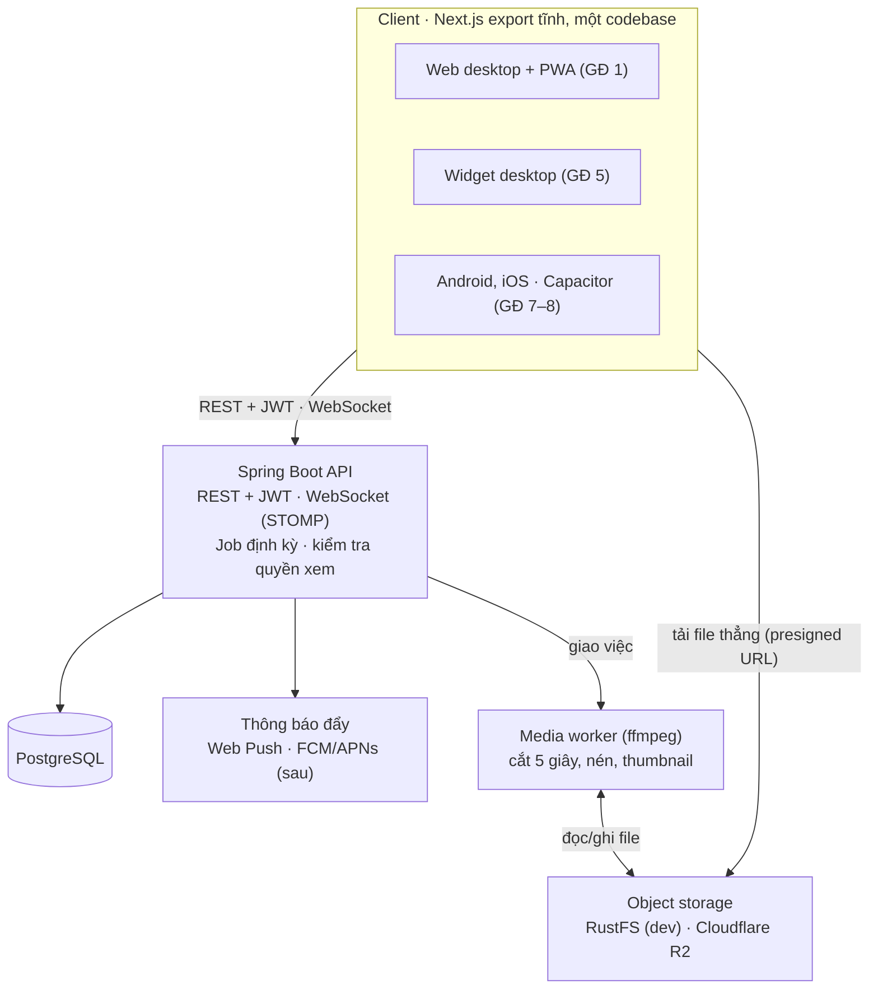

# Khoảnh khắc – Kế hoạch tổng quan

Cập nhật: 16/11/2026 · Bản gốc: https://claude.ai/artifact/QJPSak8w4TvjHHkxLkpUuk

## Tầm nhìn và nguyên tắc

Khoảnh khắc là mạng xã hội nhỏ cho nhóm bạn thân (tối đa 15 người ở bản miễn phí). Người dùng chụp nhanh một cảnh đẹp để bạn bè cùng thấy, rồi chọn giữ lại những khoảnh khắc đáng nhớ để chúng quay lại sau này. Người dùng chính là sinh viên và người đi làm 20–40 tuổi. Đây là dự án portfolio cá nhân, một người phát triển, chạy trên web desktop trước và mở rộng sang các nền tảng khác sau.

Ba nguyên tắc dẫn mọi quyết định:

1. **Chia sẻ thì nhanh.** Mở, chụp, thêm vài chữ, gửi. Khoảnh khắc chia sẻ chỉ sống 24 giờ.
2. **Lưu giữ có chọn lọc.** Người dùng tự chọn khoảnh khắc nào được giữ mãi; chỉ những khoảnh khắc đó chiếm dung lượng lâu dài.
3. **Ký ức quay lại.** Khoảnh khắc lưu giữ được nhắc lại, trang trí lại, xuất ra và chia sẻ. Đây là điểm khác biệt chính so với Locket.

## Các quyết định đã chốt

| Chủ đề | Quyết định |
| --- | --- |
| Nền tảng | Web desktop trước, cài được như app (PWA); Android, iOS phát triển sau |
| Khoảnh khắc chia sẻ | Hiển thị 24 giờ rồi file bị xóa; đổi sang lưu giữ được trong 24 giờ đó |
| Khoảnh khắc lưu giữ | Giữ mãi; chủ và người nhận ban đầu xem lại được |
| Hủy kết bạn | Mất quyền xem các khoảnh khắc lưu giữ của nhau |
| Lưu khoảnh khắc của bạn bè | Chưa làm |
| Video | Tối đa 5 giây |
| Nguồn ảnh | Chụp trực tiếp hoặc tải từ máy (gắn nhãn "tải lên") |
| Chữ | Caption ngắn trên ảnh, giới hạn theo dòng; ghi chú dài bên dưới |
| Rate | Bỏ |
| Người nhận | Tất cả bạn bè (mặc định) hoặc chọn vài người |
| Bạn bè | Tối đa 15 ở bản miễn phí; kết bạn qua link mời và mã QR |
| Feed | Từng khoảnh khắc, vuốt dọc |
| Reaction | Emoji, chỉ chủ khoảnh khắc thấy |
| Trả lời khoảnh khắc | Đi vào chat 1-1, kèm ảnh thu nhỏ của khoảnh khắc gốc |
| Chat | 1-1 trước, nhóm chưa làm |
| Đăng nhập | Email + mật khẩu và Google |
| Ngôn ngữ giao diện | Song ngữ Việt–Anh (i18n từ đầu) |
| Triển khai | Một VPS chạy Docker Compose |
| Mục đích | Dự án portfolio |

## Phạm vi MVP

MVP là bản web desktop mà một nhóm bạn thật dùng được để chia sẻ và lưu giữ khoảnh khắc. Chi tiết nằm ở [Đặc tả MVP](../01-san-pham/dac-ta-mvp.md).

**Có trong MVP:** đăng ký email + mật khẩu và Google; kết bạn qua link mời và QR (tối đa 15); trình soạn khoảnh khắc (ảnh, video 5 giây, tải từ máy, caption, sticker, biểu ngữ, ghi chú); chọn chia sẻ 24h hoặc lưu giữ và người nhận; feed vuốt dọc với reaction; danh sách lưu giữ đơn giản; PWA; song ngữ; triển khai VPS với tài khoản demo.

**Chưa có trong MVP:** chat 1-1, trả lời bằng khoảnh khắc, thông báo đẩy, photobooth, "Ngày này năm trước", hộp thời gian, tổng kết cuối năm, gắn nhạc, widget, gói premium, chat nhóm, ứng dụng Android/iOS.

## Kiến trúc tổng quan

Một client Next.js tĩnh dùng chung cho mọi nền tảng, gọi một Spring Boot API; tất cả chạy chung một Docker Compose trên VPS.

File ảnh và video không đi qua API: client tải thẳng lên object storage bằng presigned URL, rồi ffmpeg worker chuẩn hóa trước khi khoảnh khắc hiện lên feed.

## Chiến lược đa nền tảng

Web desktop làm trước, nhưng code viết từ ngày đầu để sau này đóng gói bằng Capacitor cho Android rồi iOS mà không phải viết lại. Widget và một phần tính năng native là việc riêng, làm cuối.

| Nền tảng | Giai đoạn | Cách làm | Điều kiện |
| --- | --- | --- | --- |
| Web desktop (Chrome, Edge, Firefox) | 1 | Next.js export tĩnh + PWA | Không |
| Web trên điện thoại | 1 (dùng được, chưa tối ưu) | Cùng bản PWA | Safari iOS hạn chế camera và thông báo |
| Widget desktop | 5 | Cửa sổ nổi Document Picture-in-Picture, sau đó Tauri nếu cần | Document PiP chỉ có trên trình duyệt nhân Chromium |
| Android | 7 | Capacitor 8 trở lên | Android Studio, điện thoại thật qua USB (không cần máy ảo) |
| iOS | 8 | Capacitor, Swift Package Manager | Mac + Xcode hoặc dịch vụ build đám mây; tài khoản Apple Developer |
| Widget màn hình điện thoại | 8 | Swift (WidgetKit), Kotlin, plugin cầu nối dữ liệu | Như iOS và Android |

**Quy tắc viết code ngay từ MVP để sau này không phải viết lại**

1. Next.js chạy `output: 'export'`: không dùng SSR, Server Actions hay API Routes; dữ liệu lấy ở phía client, route động như `/moment/[id]` xử lý bằng routing phía client.
2. Mọi thứ phụ thuộc nền tảng đi qua một lớp interface: `CameraService`, `NotificationService`, `ShareService`, `TokenStore`, `GoogleSignIn`. MVP chỉ viết bản web; bản native thêm sau.
3. JWT gửi qua header `Authorization`, không phụ thuộc cookie. Refresh token cất qua `TokenStore` (web dùng cookie httpOnly cùng tên miền, native dùng Keychain/Keystore).
4. Đăng nhập Google qua một endpoint nhận ID token (`POST /api/v1/auth/google`), backend xác minh với Google rồi cấp JWT. Web lấy ID token bằng Google Identity Services, app native lấy bằng plugin. Không dùng flow redirect `oauth2Login`, vì Google chặn đăng nhập trong WebView.
5. Link mời có dạng `https://<tên-miền>/invite/<mã>` để sau này gắn Universal Links và App Links.
6. CORS cấu hình bằng danh sách origin, thêm origin của app Capacitor chỉ bằng cấu hình.
7. Giao diện thiết kế mobile-first (khung 390 px như bản mẫu) dù chạy desktop trước.
8. Server luôn chuẩn hóa media bằng ffmpeg, không tin vào định dạng hay thời lượng client gửi lên, nên mọi nền tảng đều ra cùng một kết quả.

## Lộ trình

Tám giai đoạn, làm tuần tự: sáu giai đoạn đầu trên web desktop, hai giai đoạn cuối đưa sản phẩm lên Android rồi iOS. Chưa gắn mốc thời gian; sẽ ước lượng sau khi có đặc tả MVP.

```mermaid
flowchart LR
    P1["1 · MVP<br/>Đăng nhập, kết bạn<br/>Soạn khoảnh khắc<br/>Chia sẻ 24h, lưu giữ<br/>Feed và reaction"]
    P2["2 · Kết nối<br/>Chat 1-1 realtime<br/>Đáp bằng khoảnh khắc<br/>Thông báo đẩy (web)"]
    P3["3 · Ký ức<br/>Kho polaroid, yêu thích<br/>Ngày này năm trước<br/>Photobooth 4 ô"]
    P4["4 · Thời gian<br/>Hộp thời gian<br/>Tổng kết cuối năm"]
    P5["5 · Mở rộng desktop<br/>Widget Document PiP<br/>Gắn nhạc Spotify<br/>Widget Tauri (tùy)"]
    P6["6 · Premium<br/>Giới hạn theo gói<br/>Bộ trang trí riêng<br/>Thanh toán thử nghiệm"]
    P7["7 · Android<br/>Spike trên máy thật<br/>Đóng gói Capacitor<br/>Camera, push, Google Sign-In native"]
    P8["8 · iOS + widget<br/>Build cần Mac<br/>Widget màn hình chính"]
    P1 --> P2 --> P3 --> P4 --> P5 --> P6 --> P7 --> P8
```

Ký ức đứng ở giai đoạn 3 vì cần có khoảnh khắc lưu giữ trước; nhạc để giai đoạn 5 vì rủi ro API cao nhất; Android mở đầu bằng spike thử camera, đăng nhập Google native và thông báo đẩy trên máy thật.

## Rủi ro và ràng buộc

Rủi ro lớn nhất nằm ở bên thứ ba (Spotify, Apple, Google), không nằm ở stack; các tính năng phụ thuộc vào họ đều để sau MVP.

| Rủi ro | Ảnh hưởng | Cách xử lý |
| --- | --- | --- |
| Spotify siết Web API từ 02/2026: Development Mode cần Premium, tối đa 5 người dùng được ủy quyền, tìm kiếm tối đa 10 kết quả | Gắn nhạc khó mở rộng | Cho dán link hoặc tìm bài, chỉ lưu `track_id`; phát qua trình nhúng chính thức |
| Trình nhúng Spotify thường chỉ phát bản preview; `seek` được mô tả cho podcast | Không hứa chọn đoạn nhạc tùy ý | Làm bản thử nhỏ trước khi thiết kế giao diện nhạc |
| Document PiP chỉ có trên Chromium và đóng khi tắt tab chính | Widget desktop không chạy mọi nơi | Hiện nút mở widget chỉ khi trình duyệt hỗ trợ; Tauri là phương án sau |
| Google chặn OAuth trong WebView nhúng | Đăng nhập Google trên app native | Endpoint nhận ID token ngay từ MVP |
| Plugin quay video của Capacitor từng có lỗi trên iOS | Quay video 5 giây trên iPhone | Mở đầu giai đoạn 7 bằng spike trên máy thật |
| iOS cần Mac và tài khoản Apple Developer trả phí | Chi phí và công cụ | Android trước; iOS khi có Mac hoặc dùng build đám mây |
| Webcam desktop chất lượng thấp | Ảnh trên desktop kém đẹp | Cho tải ảnh từ máy, gắn nhãn "tải lên" |
| Hiệu ứng mờ (glassmorphism) nặng trên máy yếu | Giao diện giật | Chỉ dùng cho lớp đè nhỏ trên ảnh; có phương án nền đặc |
| Tổng kết cuối năm cần dữ liệu cả năm | Nhà tuyển dụng không xem được | Tài khoản demo có dữ liệu mẫu |
| Hộp thời gian bị xem trước ngày mở | Mất ý nghĩa tính năng | Server không cấp presigned URL trước `unlock_at` |

Nguồn:
- [Spotify – Update on Developer Access (02/2026)](https://developer.spotify.com/blog/2026-02-06-update-on-developer-access-and-platform-security)
- [Spotify Web API: modes và giới hạn](https://www.activepieces.com/blog/spotify-web-api-free-access-modes-scopes-limits.md)
- [Spotify iFrame API](https://developer.spotify.com/documentation/embeds/references/iframe-api)
- [Capacitor Support Policy](https://capacitorjs.com/docs/next/main/reference/support-policy)
- [Lỗi quay video iOS – Ionic Forum](https://forum.ionicframework.com/t/capacitor-camera-preview-not-initiating-video-recording-on-ios-platform/244509)

## Việc tiếp theo

- [x] Viết đặc tả MVP chi tiết: user story và luồng màn hình (bản nháp 1)
- [x] Thiết kế database (bản nháp 1)
- [x] Danh sách API REST và quy ước lỗi (bản nháp 1)
- [ ] Chọn lại font và thử glassmorphism trên bản mẫu
- [ ] Dựng khung repo: Spring Boot, Next.js export tĩnh, Docker Compose (PostgreSQL, RustFS thay MinIO theo D-010)

Câu hỏi mở: tên miền và nhà cung cấp VPS chưa chọn.
