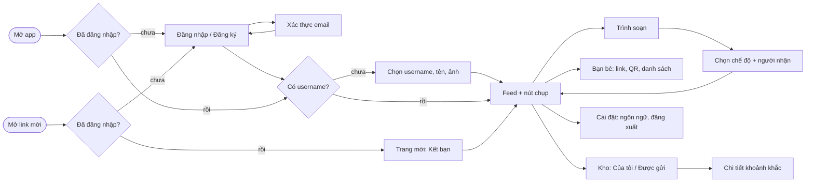

# Đặc tả MVP

Phiên bản: bản chốt 1 · Cập nhật: 16/11/2026 · Liên quan: [Kế hoạch tổng quan](../00-tong-quan/ke-hoach-tong-quan.md), [Thiết kế database](../02-ky-thuat/thiet-ke-database.md), [Danh sách API](../02-ky-thuat/danh-sach-api.md)

MVP là bản web desktop (cài được như PWA) cho phép một nhóm bạn tối đa 15 người chia sẻ khoảnh khắc 24 giờ, chọn lưu giữ những khoảnh khắc đáng nhớ, và thả reaction. Tài liệu này là nguồn sự thật cho hành vi của hệ thống; database và API phải khớp với nó.

Các giả định A1–A8 đã được chủ dự án chốt ngày 16/11/2026 (D-014 → D-021); danh sách ở cuối tài liệu.

## 1. Thuật ngữ

| Thuật ngữ | Nghĩa |
| --- | --- |
| Khoảnh khắc | Một ảnh hoặc một video tối đa 5 giây, kèm caption và các lớp trang trí |
| Chủ | Người đăng khoảnh khắc |
| Người nhận | Những người bạn được chủ chọn gửi khoảnh khắc, chốt tại thời điểm đăng |
| Chế độ chia sẻ | Khoảnh khắc xem được trong 24 giờ, sau đó file bị xóa |
| Chế độ lưu giữ | Khoảnh khắc giữ mãi trong kho của chủ và của người nhận |
| Lớp trang trí | Caption, sticker, biểu ngữ đặt lên ảnh; lưu dạng JSON tách khỏi ảnh gốc |
| Bản ghép | Ảnh đã vẽ sẵn các lớp trang trí, dùng để hiển thị nhanh |
| Cửa sổ feed | 24 giờ kể từ lúc khoảnh khắc được đăng |

## 2. Quy tắc nghiệp vụ

### Tài khoản

- **BR-01** Đăng ký bằng email + mật khẩu (tối thiểu 8 ký tự) hoặc bằng Google. Tài khoản email phải xác thực email trước khi đăng nhập được.
- **BR-02** Username duy nhất, 3–20 ký tự gồm `a-z`, `0-9`, `.`, `_`; không phân biệt hoa thường. Tên hiển thị tối đa 40 ký tự.
- **BR-03** Đăng nhập Google với email trùng một tài khoản email đã xác thực thì tự liên kết vào tài khoản đó (chỉ khi Google báo `email_verified = true`).

### Bạn bè

- **BR-04** Mỗi người có đúng một mã mời đang hoạt động. Link mời và mã QR chứa cùng một mã. Người dùng có thể tạo mã mới; mã cũ mất hiệu lực ngay.
- **BR-05** Mở link mời và bấm "Kết bạn" thì hai người thành bạn ngay, không cần chủ link duyệt lại (gửi link = đồng ý trước).
- **BR-06** Mỗi người tối đa 15 bạn. Kết bạn bị từ chối nếu một trong hai bên đã đủ 15. Không tự kết bạn với chính mình; đã là bạn thì không báo lỗi, trả về trạng thái hiện tại.
- **BR-07** Hủy kết bạn có hiệu lực với cả hai bên ngay lập tức: hai người mất quyền xem mọi khoảnh khắc của nhau, kể cả khoảnh khắc lưu giữ. Kết bạn lại thì quyền xem quay lại (người nhận không bị xóa khỏi danh sách đã chốt).

### Khoảnh khắc

- **BR-08** Một khoảnh khắc có đúng một ảnh hoặc một video. Video sau xử lý dài tối đa 5 giây.
- **BR-09** Nguồn ảnh là "chụp trực tiếp" hoặc "tải lên"; khoảnh khắc tải lên luôn hiện nhãn "tải lên".
- **BR-10** File tải lên: ảnh JPEG, PNG, WebP tối đa 15 MB; video MP4, WebM, MOV tối đa 50 MB và 60 giây. Video dài hơn 5 giây phải kèm điểm bắt đầu; server tự cắt đúng 5 giây từ điểm đó.
- **BR-11** Caption tối đa 80 ký tự hiển thị và 3 dòng. Tối đa 20 lớp trang trí; chữ trong mỗi sticker hoặc biểu ngữ tối đa 40 ký tự hiển thị. "Ký tự hiển thị" đếm theo grapheme, nên một emoji hay một chữ có dấu tính là 1.
- **BR-12** Người nhận là "tất cả bạn bè" (mặc định) hoặc một danh sách chọn từ bạn bè hiện tại, ít nhất 1 người. Danh sách người nhận được chốt khi đăng; bạn kết sau không thấy khoảnh khắc cũ.
- **BR-13** Khoảnh khắc chỉ hiện với người nhận khi đã xử lý xong. Cửa sổ feed tính từ lúc chủ bấm gửi.
- **BR-14** Chế độ chia sẻ: hết 24 giờ thì khoảnh khắc biến khỏi feed, file bị xóa khỏi kho lưu trữ, bản ghi được giữ ở trạng thái hết hạn.
- **BR-15** Chế độ lưu giữ: hết 24 giờ thì khoảnh khắc rời feed nhưng vẫn nằm trong kho của chủ và của người nhận.
- **BR-16** Chủ được chuyển khoảnh khắc từ chia sẻ sang lưu giữ khi nó còn trong 24 giờ. Không có chiều ngược lại; muốn bỏ thì xóa.
- **BR-17** Sau khi đăng, nội dung khoảnh khắc (ảnh, caption, lớp trang trí, người nhận) không sửa được trong MVP.
- **BR-18** Chủ xóa khoảnh khắc bất kỳ lúc nào. Xóa thì file bị xóa, khoảnh khắc biến mất với mọi người, reaction bị xóa theo.

### Quyền xem

- **BR-19** Một người xem được khoảnh khắc khi và chỉ khi khoảnh khắc chưa bị xóa và:
  - người đó là chủ, hoặc
  - người đó nằm trong danh sách người nhận, **đang là bạn** của chủ, và khoảnh khắc còn trong 24 giờ hoặc ở chế độ lưu giữ.
- **BR-20** Server kiểm tra quyền xem ở mọi API trả về khoảnh khắc và chỉ cấp URL tải file (có thời hạn) cho người có quyền.

### Reaction

- **BR-21** Bộ emoji cố định: ❤️ 😍 🔥 😂 😮 😢. Mỗi người tối đa một reaction trên một khoảnh khắc; thả emoji khác thì thay emoji cũ; thả lại đúng emoji đang chọn thì gỡ.
- **BR-22** Chỉ chủ thấy ai đã thả reaction gì. Người thả chỉ thấy reaction của chính mình.
- **BR-23** Chủ không tự thả reaction vào khoảnh khắc của mình.
- **BR-24** Chỉ thả reaction được khi đang có quyền xem khoảnh khắc (BR-19).

## 3. User story và tiêu chí chấp nhận

Mức ưu tiên: **Must** bắt buộc cho MVP, **Should** làm nếu kịp.

### E1. Tài khoản

| ID | Story | Ưu tiên |
| --- | --- | --- |
| US-01 | Là người mới, tôi đăng ký bằng email và mật khẩu | Must |
| US-02 | Là người mới, tôi xác thực email qua link gửi tới hộp thư | Must |
| US-03 | Là người dùng, tôi đăng nhập bằng email + mật khẩu | Must |
| US-04 | Là người dùng, tôi đăng nhập bằng Google | Must |
| US-05 | Là người dùng quên mật khẩu, tôi đặt lại qua email | Must |
| US-06 | Là người dùng mới, tôi chọn username, tên hiển thị và ảnh đại diện | Must |
| US-07 | Là người dùng, tôi đổi ngôn ngữ giao diện Việt/Anh | Must |
| US-08 | Là người dùng, tôi đăng xuất khỏi thiết bị hiện tại | Must |
| US-09 | Là người dùng, tôi xóa tài khoản cùng toàn bộ dữ liệu | Should |

Tiêu chí chấp nhận:

- **US-01** Email sai định dạng hoặc đã dùng → báo lỗi tại trường đó. Đăng ký thành công → gửi email xác thực, màn hình báo "kiểm tra hộp thư". Thông báo không tiết lộ email đã tồn tại hay chưa ở luồng quên mật khẩu.
- **US-02** Link xác thực dùng một lần, hết hạn sau 24 giờ. Link hết hạn → có nút gửi lại.
- **US-03** Sai email hoặc mật khẩu → một thông báo chung, không nói sai phần nào. Chưa xác thực email → báo và cho gửi lại email. Quá 5 lần sai trong 15 phút cho cùng email → tạm khóa đăng nhập 15 phút.
- **US-04** Lần đầu đăng nhập Google → tạo tài khoản rồi vào bước chọn username (US-06). Áp dụng BR-03.
- **US-05** Link đặt lại mật khẩu dùng một lần, hết hạn sau 1 giờ. Đặt lại thành công → mọi phiên đăng nhập cũ bị thu hồi.
- **US-06** Chưa có username thì chưa vào được feed. Ảnh đại diện là ảnh vuông, server cắt về 256×256.
- **US-07** Ngôn ngữ mặc định theo trình duyệt (vi hoặc en, còn lại → en). Lựa chọn được lưu vào tài khoản.
- **US-09** Yêu cầu nhập lại mật khẩu (hoặc đăng nhập Google lại). Xóa mọi khoảnh khắc, file, reaction, quan hệ bạn bè của người đó.

### E2. Bạn bè

| ID | Story | Ưu tiên |
| --- | --- | --- |
| US-10 | Là người dùng, tôi lấy link mời và mã QR của mình để gửi bạn bè | Must |
| US-11 | Là người được mời, tôi mở link, xem ai mời và bấm kết bạn | Must |
| US-12 | Là người dùng, tôi xem danh sách bạn bè và số chỗ còn lại (x/15) | Must |
| US-13 | Là người dùng, tôi hủy kết bạn | Must |
| US-14 | Là người dùng, tôi tạo mã mời mới khi link cũ bị lộ | Should |

Tiêu chí chấp nhận:

- **US-10** Trang bạn bè có nút sao chép link và mã QR hiển thị ngay (tạo ở client từ link).
- **US-11** Chưa đăng nhập → đăng nhập/đăng ký xong quay lại đúng trang mời. Trang mời hiện ảnh đại diện, tên hiển thị, username của người mời. Các lỗi: mã không tồn tại hoặc đã đổi, tự mời chính mình, một bên đủ 15 bạn (BR-06) — mỗi lỗi có thông báo riêng.
- **US-13** Có hộp xác nhận. Áp dụng BR-07.
- **US-14** Áp dụng BR-04; link cũ mở ra báo "link không còn hiệu lực".

### E3. Soạn và đăng khoảnh khắc

| ID | Story | Ưu tiên |
| --- | --- | --- |
| US-20 | Là người dùng, tôi chụp ảnh bằng camera của máy | Must |
| US-21 | Là người dùng, tôi quay video tối đa 5 giây | Must |
| US-22 | Là người dùng, tôi tải ảnh hoặc video có sẵn và chọn đoạn 5 giây | Must |
| US-23 | Là người dùng, tôi thêm caption trên ảnh | Must |
| US-24 | Là người dùng, tôi thêm sticker và biểu ngữ, kéo thả, xoay, phóng to | Must |
| US-26 | Là người dùng, tôi chọn chia sẻ 24h hoặc lưu giữ | Must |
| US-27 | Là người dùng, tôi chọn gửi cho tất cả hoặc vài người bạn | Must |
| US-28 | Là người dùng, tôi thấy khoảnh khắc vừa gửi hiện mờ trong lúc đang tải lên và xử lý, rồi rõ nét khi đã đăng xong | Must |

Tiêu chí chấp nhận:

- **US-20/21** Trình duyệt chưa cấp quyền camera → hướng dẫn cấp quyền, vẫn cho dùng US-22. Quay video tự dừng ở 5 giây, có đồng hồ đếm.
- **US-22** Video dài hơn 5 giây → hiện thanh chọn đoạn; điểm bắt đầu gửi lên server (BR-10). File sai định dạng hoặc quá dung lượng → báo trước khi tải lên.
- **US-23/24** Áp dụng BR-11; khi gõ quá giới hạn thì không nhận thêm ký tự và hiện bộ đếm. Caption tự xuống dòng trong vùng an toàn và tự thu nhỏ cỡ chữ.
- **US-26** Mặc định là chia sẻ 24h. Có một dòng giải thích ngắn cho từng chế độ.
- **US-27** Chưa có bạn nào → không gửi được, hiện lối tắt sang trang mời bạn. Áp dụng BR-12.
- **US-28** Sau khi bấm gửi, khoảnh khắc hiện bằng ảnh xem trước tạo ở máy (bản ghép với ảnh, khung hình đầu với video) bị làm mờ; không dùng thanh tiến trình hay số phần trăm. Khi khoảnh khắc chuyển sang trạng thái sẵn sàng, ảnh chuyển sang rõ nét. Với ảnh, client tải lên cả ảnh gốc và bản ghép. Mất mạng giữa chừng → ảnh vẫn mờ, cho thử lại mà không phải soạn lại. Xử lý thất bại → báo lỗi và cho thử lại hoặc hủy.

### E4. Xem và tương tác

| ID | Story | Ưu tiên |
| --- | --- | --- |
| US-30 | Là người dùng, tôi xem feed khoảnh khắc của bạn bè và của mình, vuốt dọc từng cái | Must |
| US-31 | Là người dùng, tôi thấy khoảnh khắc chia sẻ còn bao lâu | Must |
| US-32 | Là người dùng, tôi thả reaction emoji | Must |
| US-33 | Là chủ, tôi xem ai đã thả reaction gì | Must |
| US-34 | Là chủ, tôi chuyển khoảnh khắc sang lưu giữ | Must |
| US-35 | Là chủ, tôi xóa khoảnh khắc | Must |

Tiêu chí chấp nhận:

- **US-30** Feed gồm các khoảnh khắc trong cửa sổ 24 giờ mà tôi xem được (BR-19), mới nhất trước, tải thêm khi cuộn. Video tự phát không tiếng, lặp lại; bấm để bật tiếng. Feed trống → gợi ý chụp khoảnh khắc đầu tiên hoặc mời bạn.
- **US-31** Khoảnh khắc chia sẻ hiện "còn X giờ" (dưới 1 giờ thì "còn X phút"). Khoảnh khắc lưu giữ hiện nhãn "lưu giữ".
- **US-32** Áp dụng BR-21 đến BR-24.
- **US-34** Áp dụng BR-16; nhãn đổi ngay sau khi chuyển.
- **US-35** Có hộp xác nhận. Áp dụng BR-18.

### E5. Kho lưu giữ (bản đơn giản)

| ID | Story | Ưu tiên |
| --- | --- | --- |
| US-40 | Là người dùng, tôi xem các khoảnh khắc lưu giữ của mình, nhóm theo tháng | Must |
| US-41 | Là người dùng, tôi xem các khoảnh khắc lưu giữ bạn bè đã gửi cho tôi | Must |
| US-42 | Là người dùng, tôi mở một khoảnh khắc trong kho để xem đầy đủ | Must |

Tiêu chí chấp nhận:

- **US-40/41** Hai tab "Của tôi" và "Được gửi", lưới ảnh thu nhỏ, mới nhất trước, tải thêm khi cuộn. Tab "Được gửi" tuân theo BR-19 (hủy kết bạn thì biến mất).
- **US-42** Hiện đầy đủ ảnh/video, caption, ngày đăng.

### E6. Ứng dụng và vận hành

| ID | Story | Ưu tiên |
| --- | --- | --- |
| US-50 | Là người dùng, tôi cài Khoảnh khắc như một app trên máy tính | Must |
| US-51 | Là nhà tuyển dụng, tôi đăng nhập tài khoản demo có sẵn bạn bè và khoảnh khắc | Must |
| US-52 | Là chủ dự án, tôi triển khai toàn bộ hệ thống bằng một lệnh Docker Compose | Must |

- **US-50** Có web app manifest, icon, service worker cache phần giao diện tĩnh (không cache dữ liệu riêng tư).
- **US-51** Thông tin đăng nhập demo hiện trên trang đăng nhập. Dữ liệu demo được dựng lại bằng script seed; tài khoản demo không đổi được mật khẩu và không xóa được tài khoản; mọi thao tác khác như tài khoản thường. Script seed chạy lại hằng ngày (D-027).

## 4. Luồng màn hình

Bản mẫu giao diện cho feed, trình soạn, kho: https://claude.ai/artifact/2mx7iFqeANEgVFoyfP4ryx

## 5. Yêu cầu phi chức năng

| Nhóm | Yêu cầu |
| --- | --- |
| Trình duyệt | 2 phiên bản mới nhất của Chrome, Edge, Firefox trên desktop; Safari và trình duyệt điện thoại: dùng được, không cam kết |
| Hiệu năng | Feed hiện khoảnh khắc đầu tiên trong 2 giây trên mạng 4G; ảnh hiển thị dài tối đa 1440 px, thumbnail 480 px |
| Xử lý media | Khoảnh khắc ảnh sẵn sàng trong 10 giây, video trong 30 giây sau khi tải xong (VPS 2 vCPU) |
| Bảo mật | Mật khẩu băm BCrypt; access token 15 phút, refresh token 30 ngày có xoay vòng; URL file có hạn 10 phút; giới hạn tần suất cho đăng nhập, đăng ký, quên mật khẩu |
| Riêng tư | Mọi API kiểm tra quyền xem (BR-19); không log token, mật khẩu, nội dung caption; bucket lưu trữ không công khai |
| Khả năng truy cập | Tương phản chữ tối thiểu 4.5:1; mọi nút có nhãn; điều khiển được bằng bàn phím |
| Đa ngôn ngữ | Mọi chuỗi giao diện và thông báo lỗi có bản vi và en |
| Kiểm thử | Unit test cho quy tắc nghiệp vụ; integration test API với PostgreSQL và object storage chuẩn S3 (RustFS) thật (Testcontainers); E2E cho luồng đăng ký → kết bạn → đăng → reaction |
| Vận hành | Job dọn dẹp chạy mỗi 5 phút; log có request id; backup PostgreSQL hằng ngày |

## 6. Ngoài phạm vi MVP

Ghi chú dài dưới ảnh, chat 1-1, trả lời bằng khoảnh khắc, thông báo đẩy, photobooth, "Ngày này năm trước", yêu thích, hộp thời gian, tổng kết cuối năm, gắn nhạc, widget, gói premium, chat nhóm, sửa khoảnh khắc sau khi đăng, lưu khoảnh khắc của bạn bè, ứng dụng Android/iOS.

## 7. Giả định đã chốt

Tất cả chốt theo phương án đề xuất ngày 16/11/2026 (D-014 → D-021). Cột "Phương án khác" giữ lại để biết lựa chọn đã cân nhắc.

| Mã | Giả định | Phương án khác |
| --- | --- | --- |
| A1 | Có danh sách lưu giữ đơn giản trong MVP (E5) | Bỏ E5, đợi kho polaroid ở giai đoạn 3 |
| A2 | Link mời = kết bạn ngay, không cần duyệt (BR-05) | Gửi lời mời, chủ link duyệt |
| A3 | Không chuyển lưu giữ về chia sẻ (BR-16) | Cho chuyển lại khi còn trong 24 giờ |
| A4 | Không sửa khoảnh khắc sau khi đăng (BR-17) | Cho sửa caption |
| A5 | Một reaction/người/khoảnh khắc, bộ 6 emoji cố định (BR-21) | Nhiều reaction, chọn emoji tự do |
| A6 | Tự liên kết tài khoản Google trùng email đã xác thực (BR-03) | Báo lỗi, bắt đăng nhập bằng mật khẩu rồi liên kết |
| A7 | Hủy rồi kết bạn lại thì quyền xem khoảnh khắc cũ quay lại (BR-07) | Mất vĩnh viễn |
| A8 | Khoảnh khắc của chính mình cũng hiện trong feed (US-30) | Chỉ hiện của bạn bè |
