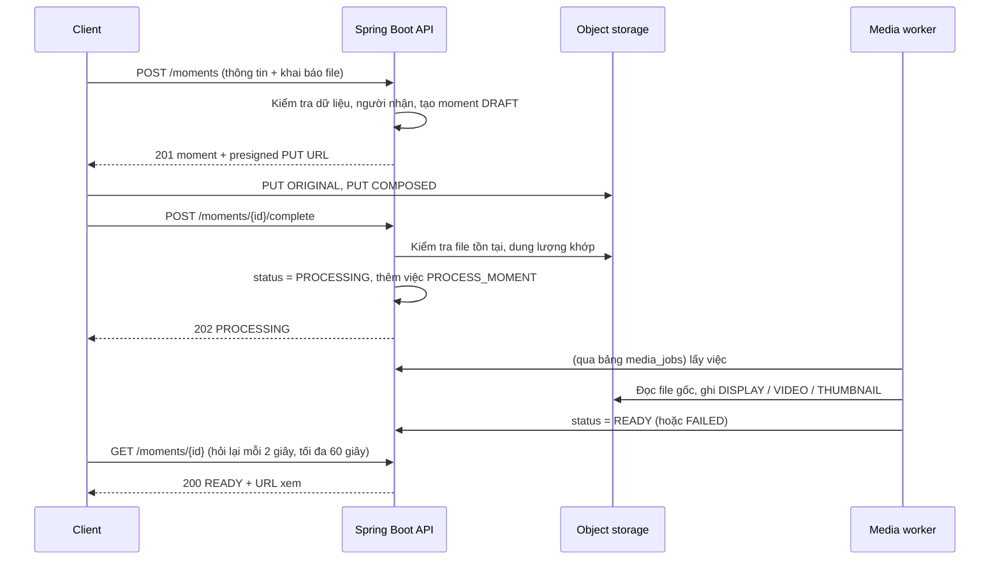

# Danh sách API (MVP)

Phiên bản: bản chốt 1 · Cập nhật: 16/11/2026 · Dựa trên: [Đặc tả MVP](../01-san-pham/dac-ta-mvp.md), [Thiết kế database](../02-ky-thuat/thiet-ke-database.md)

MVP có 32 endpoint REST dưới tiền tố `/api/v1`, chia 5 nhóm. Không có WebSocket trong MVP (chat và realtime ở giai đoạn 2). File ảnh/video không đi qua API: API cấp presigned URL, client tải thẳng lên object storage.

## 1. Quy ước chung

| Mục | Quy ước |
| --- | --- |
| Định dạng | JSON, UTF-8, tên trường `camelCase`, thời gian ISO 8601 UTC (`2026-11-16T02:30:00Z`) |
| Xác thực | `Authorization: Bearer <accessToken>`; access token là JWT hết hạn sau 15 phút |
| Loại client | Header `X-Client-Type: web` hoặc `native` quyết định cách trả refresh token (mục 2) |
| Ngôn ngữ | `Accept-Language: vi` hoặc `en`; quyết định ngôn ngữ của `title`/`detail` trong lỗi. Thiếu header hoặc ngôn ngữ khác → `en` |
| Truy vết | Server trả `X-Request-Id` trong mọi phản hồi; client có thể gửi sẵn header này |
| Phân trang | Con trỏ: `?cursor=<chuỗi>&limit=<số>`; phản hồi có `items` và `nextCursor` (`null` khi hết). Con trỏ là chuỗi mờ, client không tự tạo |
| Không có quyền xem | Trả `404 NOT_FOUND`, không trả `403`, để không lộ khoảnh khắc có tồn tại hay không (BR-20) |
| Hồ sơ chưa xong | Người dùng chưa có username gọi API ngoài nhóm Auth và `/me` → `403 PROFILE_INCOMPLETE` |

### Định dạng lỗi

Lỗi trả theo RFC 9457 (Problem Details), `Content-Type: application/problem+json`, thêm hai trường `code` và `errors`:

```json
{
  "type": "https://moment.app/errors/validation-failed",
  "title": "Dữ liệu không hợp lệ",
  "status": 400,
  "detail": "Có 1 trường không hợp lệ.",
  "code": "VALIDATION_FAILED",
  "errors": [
    { "field": "caption", "code": "TOO_LONG", "message": "Caption tối đa 80 ký tự." }
  ],
  "requestId": "01JD3K7Q9X..."
}
```

Client dựa vào `code` để xử lý; `title`, `detail`, `message` chỉ để hiển thị.

Mã lỗi của từng trường trong `errors`: `REQUIRED` (thiếu), `INVALID_FORMAT` (sai định dạng), `TOO_SHORT`, `TOO_LONG` (độ dài, đếm theo ký tự hiển thị với chữ người dùng nhập), `INVALID` (giá trị khác không hợp lệ). Body không đọc được (JSON hỏng, thiếu tham số) trả `VALIDATION_FAILED` không có `errors`. Đường dẫn hoặc phương thức không tồn tại trả `404 NOT_FOUND`.

## 2. Xác thực và phiên đăng nhập

Đăng nhập thành công (email/mật khẩu hoặc Google) trả access token trong body. Access token có claim `auth_time` là thời điểm người dùng xác thực bằng mật khẩu hoặc Google; refresh không đổi `auth_time` (D-026). Refresh token (hết hạn 30 ngày, xoay vòng mỗi lần dùng) trả theo loại client:

- `X-Client-Type: web` → cookie `moment_rt`, `HttpOnly`, `Secure`, `SameSite=Strict`, `Path=/api/v1/auth`. Body không chứa refresh token.
- `X-Client-Type: native` → trường `refreshToken` trong body; app lưu vào Keychain/Keystore.

Một refresh token đã dùng mà bị dùng lại → thu hồi cả family của nó và trả `401 TOKEN_REUSED` (dấu hiệu token bị lộ).

Phản hồi đăng nhập mẫu:

```json
{
  "accessToken": "eyJhbGciOi...",
  "expiresIn": 900,
  "user": {
    "id": "3f6c1a52-8a1e-4c55-9f0b-2b1c8d2f7e10",
    "email": "trung@example.com",
    "username": null,
    "displayName": null,
    "avatarUrl": null,
    "locale": "vi",
    "needsOnboarding": true,
    "friendCount": 0,
    "friendLimit": 15,
    "isDemo": false
  }
}
```

## 3. Danh sách endpoint

Cột "Xác thực": **Không** = công khai, **Có** = cần access token.

### 3.1 Auth

| Phương thức | Đường dẫn | Xác thực | Mô tả | Story |
| --- | --- | --- | --- | --- |
| POST | `/auth/register` | Không | Đăng ký email + mật khẩu, gửi email xác thực | US-01 |
| POST | `/auth/verify-email` | Không | Xác thực email bằng token trong link | US-02 |
| POST | `/auth/resend-verification` | Không | Gửi lại email xác thực | US-02 |
| POST | `/auth/login` | Không | Đăng nhập email + mật khẩu | US-03 |
| POST | `/auth/google` | Không | Đăng nhập bằng Google ID token | US-04 |
| POST | `/auth/refresh` | Không (refresh token) | Lấy access token mới, xoay vòng refresh token | — |
| POST | `/auth/logout` | Có | Thu hồi refresh token hiện tại | US-08 |
| POST | `/auth/forgot-password` | Không | Gửi email đặt lại mật khẩu | US-05 |
| POST | `/auth/reset-password` | Không | Đặt mật khẩu mới bằng token, thu hồi mọi phiên | US-05 |

Chi tiết:

- `POST /auth/register` — body `{ "email", "password", "locale"? }` → `201`, không có body. `password` tối thiểu 8 ký tự hiển thị và tối đa 72 byte UTF-8 (giới hạn của BCrypt); `locale` thiếu thì dùng `vi`. Lỗi: `VALIDATION_FAILED`, `EMAIL_TAKEN` (409).
- `POST /auth/verify-email` — body `{ "token" }` → `204`. Lỗi: `TOKEN_INVALID` (400), `TOKEN_EXPIRED` (400).
- `POST /auth/resend-verification`, `POST /auth/forgot-password` — body `{ "email" }` → luôn `202`, kể cả email không tồn tại (không lộ tài khoản).
- `POST /auth/login` — body `{ "email", "password" }` → `200` như mẫu ở mục 2. Lỗi: `INVALID_CREDENTIALS` (401), `EMAIL_NOT_VERIFIED` (403), `LOGIN_LOCKED` (429, có header `Retry-After`).
- `POST /auth/google` — body `{ "idToken", "locale"? }` → `200` như đăng nhập, thêm `"isNewUser": true|false`. `locale` (`vi` hoặc `en`) chỉ dùng khi tạo tài khoản mới; thiếu thì dùng `vi` (D-023). Google báo `email_verified = false` → `GOOGLE_TOKEN_INVALID`. Email trùng một tài khoản email chưa xác thực → tài khoản đó được xác thực và bỏ mật khẩu cũ (Q-022, đang chờ chốt). Server kiểm tra chữ ký, `aud` bằng client id của dự án, `iss`, hạn dùng. Lỗi: `GOOGLE_TOKEN_INVALID` (401).
- `POST /auth/refresh` — web: không body, đọc cookie; native: body `{ "refreshToken" }` → `200 { accessToken, expiresIn }` (+ refresh token mới theo mục 2). Lỗi: `UNAUTHENTICATED`, `TOKEN_REUSED` (401).
- `POST /auth/logout` — web đọc cookie, native gửi body `{ "refreshToken" }` → `204`; web nhận thêm `Set-Cookie` xóa cookie `moment_rt`.
- `POST /auth/reset-password` — body `{ "token", "newPassword" }` → `204`. `newPassword` theo cùng quy tắc với đăng ký. Lỗi: `TOKEN_INVALID`, `TOKEN_EXPIRED`, `VALIDATION_FAILED`, `DEMO_ACCOUNT_READONLY` (403).

### 3.2 Hồ sơ của tôi

| Phương thức | Đường dẫn | Mô tả | Story |
| --- | --- | --- | --- |
| GET | `/me` | Thông tin tài khoản của tôi | US-06 |
| PATCH | `/me` | Sửa username, tên hiển thị, ngôn ngữ | US-06, US-07 |
| GET | `/usernames/{username}/availability` | Kiểm tra username còn trống | US-06 |
| POST | `/me/avatar/upload-url` | Xin URL tải ảnh đại diện | US-06 |
| POST | `/me/avatar/complete` | Báo tải ảnh đại diện xong; server cắt 256×256 | US-06 |
| DELETE | `/me` | Xóa tài khoản và toàn bộ dữ liệu | US-09 |

- `PATCH /me` — body chỉ gồm trường cần đổi: `{ "username"?, "displayName"?, "locale"? }` → `200` user. Lỗi: `USERNAME_TAKEN` (409), `VALIDATION_FAILED`.
- `GET /usernames/{username}/availability` → `200 { "available": true }`. Giới hạn tần suất để chống dò username.
- `POST /me/avatar/upload-url` — body `{ "contentType", "sizeBytes" }` (JPEG/PNG/WebP, tối đa 5 MB) → `200 { "uploadId", "upload": { "method": "PUT", "url", "headers", "expiresAt" } }`. `uploadId` là chuỗi do server ký, chứa userId, object key và hạn dùng 15 phút; không lưu vào database (D-025).
- `POST /me/avatar/complete` — body `{ "uploadId" }` → `200` user với `avatarUrl` mới. `uploadId` sai chữ ký, hết hạn hoặc của người khác → `TOKEN_INVALID` (400).
- `DELETE /me` — body `{ "password" }` cho tài khoản có mật khẩu; tài khoản chỉ có Google phải đăng nhập lại trong 5 phút gần nhất, kiểm tra qua claim `auth_time` của access token (D-026) → `204`. Lỗi: `INVALID_CREDENTIALS`, `REAUTH_REQUIRED` (403), `DEMO_ACCOUNT_READONLY`.

### 3.3 Mời và bạn bè

| Phương thức | Đường dẫn | Xác thực | Mô tả | Story |
| --- | --- | --- | --- | --- |
| GET | `/invites/me` | Có | Mã và link mời của tôi | US-10 |
| POST | `/invites/me/rotate` | Có | Tạo mã mời mới, vô hiệu mã cũ | US-14 |
| GET | `/invites/{code}` | Không | Xem người mời (cho trang mời) | US-11 |
| POST | `/invites/{code}/accept` | Có | Kết bạn qua mã mời | US-11 |
| GET | `/friends` | Có | Danh sách bạn bè | US-12 |
| DELETE | `/friends/{userId}` | Có | Hủy kết bạn | US-13 |

- `GET /invites/me`, `POST /invites/me/rotate` → `200 { "code": "k7Q2mX9a", "url": "https://<tên-miền>/invite?code=k7Q2mX9a" }`. Mã gồm 8 chữ và số; `GET /invites/me` tạo mã lần đầu nếu chưa có. Link dùng tham số `code` để frontend xuất tĩnh mở được trên mọi host (D-032). Mã QR do client tạo từ `url`.
- `GET /invites/{code}` → `200 { "inviter": { "username", "displayName", "avatarUrl" } }`. Lỗi: `INVITE_INVALID` (404).
- `POST /invites/{code}/accept` → `200 { "friend": <user tóm tắt>, "alreadyFriends": false }`; đã là bạn → `200` với `"alreadyFriends": true`. Lỗi: `INVITE_INVALID` (404), `INVITE_SELF` (422), `FRIEND_LIMIT_REACHED` (422, trường `detail` cho biết bên nào đủ 15: người bấm kết bạn hay người mời). Thứ tự kiểm tra: mã sai → tự mời mình → đã là bạn → giới hạn 15.
- `GET /friends` → `200 { "items": [ { "id", "username", "displayName", "avatarUrl", "friendsSince" } ], "count": 12, "limit": 15 }`. Không phân trang vì tối đa 15.
- `DELETE /friends/{userId}` → `204`. Không phải bạn → `404 NOT_FOUND`.

### 3.4 Khoảnh khắc

| Phương thức | Đường dẫn | Mô tả | Story |
| --- | --- | --- | --- |
| POST | `/moments` | Tạo khoảnh khắc (bản nháp) và nhận URL tải file | US-20 → US-27 |
| POST | `/moments/{id}/complete` | Báo đã tải file xong, bắt đầu xử lý | US-28 |
| POST | `/moments/{id}/retry` | Xử lý lại khoảnh khắc lỗi | US-28 |
| GET | `/moments/{id}` | Chi tiết một khoảnh khắc | US-42 |
| POST | `/moments/{id}/keep` | Chuyển sang lưu giữ | US-34 |
| DELETE | `/moments/{id}` | Xóa khoảnh khắc | US-35 |
| GET | `/feed` | Feed 24 giờ | US-30, US-31 |
| GET | `/archive` | Kho lưu giữ (`scope=mine` hoặc `received`) | US-40, US-41 |

**Tạo khoảnh khắc** — `POST /moments`:

```json
{
  "mediaType": "PHOTO",
  "source": "CAMERA",
  "mode": "SHARED",
  "audience": "SELECTED",
  "recipientIds": ["9b1e...", "c42d..."],
  "caption": "trời hôm nay đẹp quá trời ơi",
  "layers": [ { "id": "c1", "type": "caption", "text": "trời hôm nay đẹp quá trời ơi", "x": 0.5, "y": 0.88, "scale": 1, "rotation": 0, "style": "pill-dark" } ],
  "layersVersion": 1,
  "trimStartMs": null,
  "files": [
    { "variant": "ORIGINAL", "contentType": "image/jpeg", "sizeBytes": 2483112 },
    { "variant": "COMPOSED", "contentType": "image/webp", "sizeBytes": 812004 }
  ]
}
```

Phản hồi `201`:

```json
{
  "moment": { "id": "5d2f...", "status": "DRAFT", "expiresAt": "2026-11-17T02:30:00Z", "...": "..." },
  "uploads": [
    { "variant": "ORIGINAL", "method": "PUT", "url": "https://...", "headers": { "Content-Type": "image/jpeg" }, "expiresAt": "2026-11-16T02:45:00Z" },
    { "variant": "COMPOSED", "method": "PUT", "url": "https://...", "headers": { "Content-Type": "image/webp" }, "expiresAt": "2026-11-16T02:45:00Z" }
  ]
}
```

Quy tắc kiểm tra khi tạo:

- Ảnh cần đúng hai file `ORIGINAL` + `COMPOSED`; video cần đúng một file `ORIGINAL`.
- Định dạng và dung lượng theo BR-10; `COMPOSED` phải là `image/jpeg` hoặc `image/webp`.
- `audience: "ALL"` thì bỏ qua `recipientIds`, server chốt danh sách là mọi bạn bè hiện tại; `"SELECTED"` thì `recipientIds` phải có ít nhất 1 người và tất cả đều là bạn hiện tại.
- `caption`, `layers` theo BR-11 và mục 5 của thiết kế database.
- `trimStartMs` chỉ dùng cho video tải lên.

Lỗi: `VALIDATION_FAILED`, `UNSUPPORTED_MEDIA_TYPE` (415), `PAYLOAD_TOO_LARGE` (413), `NO_FRIENDS` (422), `NOT_FRIENDS` (422, mỗi id không phải bạn là một phần tử `errors` với `field: "recipientIds"`, `code: "NOT_FRIENDS"`).

Presigned URL tải lên ký cả `Content-Type` và dung lượng khai báo: client phải PUT đúng header trong `headers` và đúng số byte. Khi có lớp `caption`, cột `caption` lấy chữ của lớp đó. `layersVersion` hiện chỉ nhận `1`.

**Báo tải xong** — `POST /moments/{id}/complete`, không body → `202` moment ở trạng thái `PROCESSING`. Server kiểm tra từng file đã có trong object storage và dung lượng khớp khai báo. Lỗi: `UPLOAD_INCOMPLETE` (409), `MOMENT_NOT_DRAFT` (409), `NOT_FOUND`.

**Xử lý lại** — `POST /moments/{id}/retry` → `202`. Chỉ cho trạng thái `FAILED`, ngược lại `409 MOMENT_NOT_FAILED`.

**Chi tiết** — `GET /moments/{id}` → `200` moment (mục 4). Chủ xem được ở mọi trạng thái. Người khác chỉ xem được theo BR-19: nằm trong danh sách người nhận, đang là bạn của chủ, khoảnh khắc đã `READY` (BR-13) và còn trước `expiresAt` hoặc ở chế độ lưu giữ. Không có quyền hoặc không tồn tại → `404 NOT_FOUND`, kiểm tra qua `MomentAccessPolicy`.

**Chuyển sang lưu giữ** — `POST /moments/{id}/keep` → `200` moment. Đã là lưu giữ → `200` (không đổi gì). Quá 24 giờ hoặc đã hết hạn → `409 MOMENT_NOT_KEEPABLE`. Không phải chủ → `404`.

**Feed** — `GET /feed?cursor=&limit=` (`limit` mặc định 10, tối đa 30) → `200 { "items": [<moment>], "nextCursor": "..." }`.

**Kho** — `GET /archive?scope=mine|received&cursor=&limit=` (`limit` mặc định 30, tối đa 60) → như feed. Client tự nhóm theo tháng dựa trên `createdAt`.

### 3.5 Reaction

| Phương thức | Đường dẫn | Mô tả | Story |
| --- | --- | --- | --- |
| PUT | `/moments/{id}/reaction` | Đặt hoặc đổi reaction của tôi | US-32 |
| DELETE | `/moments/{id}/reaction` | Gỡ reaction của tôi | US-32 |
| GET | `/moments/{id}/reactions` | Ai đã thả gì (chỉ chủ) | US-33 |

- `PUT /moments/{id}/reaction` — body `{ "emoji": "🔥" }` → `200 { "emoji": "🔥" }`. Hành vi "thả lại đúng emoji thì gỡ" (BR-21) do client xử lý bằng cách gọi `DELETE`. Server chuẩn hóa emoji trước khi kiểm tra, ví dụ `❤` (U+2764 không có U+FE0F) thành `❤️` (D-028). Lỗi: `VALIDATION_FAILED` (emoji ngoài bộ cố định), `REACTION_OWN_MOMENT` (422), `NOT_FOUND` (không có quyền xem).
- `DELETE /moments/{id}/reaction` → `204`, kể cả khi chưa thả.
- `GET /moments/{id}/reactions` → `200 { "items": [ { "user": <user tóm tắt>, "emoji": "😍", "reactedAt": "..." } ] }`. Không phải chủ → `404`.

## 4. Đối tượng khoảnh khắc trả về

```json
{
  "id": "5d2f6a0e-1c3b-4a77-8e21-6f0f9b2d7c41",
  "isMine": false,
  "owner": { "id": "9b1e...", "username": "minhanh", "displayName": "Minh Anh", "avatarUrl": "https://..." },
  "mediaType": "PHOTO",
  "source": "CAMERA",
  "mode": "SHARED",
  "status": "READY",
  "caption": "trời hôm nay đẹp quá trời ơi",
  "layers": [ "..." ],
  "layersVersion": 1,
  "width": 1440,
  "height": 1920,
  "durationMs": null,
  "createdAt": "2026-11-16T02:30:00Z",
  "expiresAt": "2026-11-17T02:30:00Z",
  "keptAt": null,
  "media": {
    "displayUrl": "https://...",
    "videoUrl": null,
    "thumbnailUrl": "https://...",
    "urlsExpireAt": "2026-11-16T02:40:00Z"
  },
  "myReaction": "🔥",
  "ownerView": null
}
```

- `media` chỉ có khi `status` là `READY`; URL hết hạn sau 10 phút, client gọi lại API để lấy URL mới khi cần.
- Với video, `videoUrl` có giá trị và client vẽ `layers` đè lên lúc phát; với ảnh, `displayUrl` là bản đã ghép sẵn.
- `myReaction` chỉ có khi người xem không phải chủ.
- `ownerView` chỉ có khi người xem là chủ: `{ "audience": "SELECTED", "recipientCount": 3, "reactionCount": 2, "failureReason": null }`. Khi `status` là `FAILED`, `failureReason` là một trong: `MEDIA_UNREADABLE` (file không đọc được theo định dạng đã khai báo, hoặc lớn hơn 50 megapixel), `VIDEO_TOO_LONG` (video quá 60 giây, BR-10), `PROCESSING_ERROR` (lỗi khác sau 3 lần thử); client hiện thông báo theo mã này (D-033).

## 5. Luồng đăng một khoảnh khắc



MVP chưa có realtime nên client hỏi lại trạng thái theo chu kỳ; từ giai đoạn 2 thay bằng sự kiện qua WebSocket.

## 6. Giới hạn tần suất

| Endpoint | Giới hạn |
| --- | --- |
| `POST /auth/login` | 5 lần sai / 15 phút / email (US-03), 30 lần / phút / IP |
| `POST /auth/register` | 5 / giờ / IP |
| `POST /auth/forgot-password`, `/auth/resend-verification` | 3 / giờ / email |
| `GET /usernames/{username}/availability` | 30 / phút / người dùng |
| `POST /invites/{code}/accept`, `GET /invites/{code}` | 20 / phút / IP |
| `POST /moments` | 60 / giờ / người dùng |
| Còn lại | 300 / phút / người dùng |

Vượt giới hạn → `429 RATE_LIMITED` kèm `Retry-After`. MVP chạy một instance nên đếm trong bộ nhớ (ví dụ Bucket4j); khi chạy nhiều instance thì chuyển sang Redis.

## 7. Bảng mã lỗi

| Mã | HTTP | Khi nào |
| --- | --- | --- |
| `VALIDATION_FAILED` | 400 | Dữ liệu sai định dạng hoặc vượt giới hạn; chi tiết trong `errors` |
| `TOKEN_INVALID` | 400 | Token email không tồn tại hoặc đã dùng |
| `TOKEN_EXPIRED` | 400 | Token email hết hạn |
| `UNAUTHENTICATED` | 401 | Thiếu, sai hoặc hết hạn access/refresh token |
| `INVALID_CREDENTIALS` | 401 | Sai email hoặc mật khẩu |
| `GOOGLE_TOKEN_INVALID` | 401 | ID token Google không hợp lệ |
| `TOKEN_REUSED` | 401 | Refresh token bị dùng lại; cả family bị thu hồi |
| `EMAIL_NOT_VERIFIED` | 403 | Đăng nhập khi chưa xác thực email |
| `PROFILE_INCOMPLETE` | 403 | Chưa chọn username |
| `REAUTH_REQUIRED` | 403 | Thao tác nhạy cảm cần đăng nhập lại |
| `DEMO_ACCOUNT_READONLY` | 403 | Tài khoản demo không được đổi mật khẩu hay xóa |
| `NOT_FOUND` | 404 | Không tồn tại hoặc không có quyền xem |
| `INVITE_INVALID` | 404 | Mã mời không tồn tại hoặc đã đổi |
| `EMAIL_TAKEN` | 409 | Email đã đăng ký |
| `USERNAME_TAKEN` | 409 | Username đã có người dùng |
| `UPLOAD_INCOMPLETE` | 409 | Báo tải xong nhưng file chưa có hoặc sai dung lượng |
| `MOMENT_NOT_DRAFT` | 409 | Gọi `complete` cho khoảnh khắc không ở trạng thái `DRAFT` |
| `MOMENT_NOT_FAILED` | 409 | Gọi `retry` cho khoảnh khắc không ở trạng thái `FAILED` |
| `MOMENT_NOT_KEEPABLE` | 409 | Chuyển sang lưu giữ khi đã quá 24 giờ |
| `PAYLOAD_TOO_LARGE` | 413 | File khai báo vượt dung lượng cho phép |
| `UNSUPPORTED_MEDIA_TYPE` | 415 | Định dạng file không hỗ trợ |
| `INVITE_SELF` | 422 | Tự dùng mã mời của mình |
| `FRIEND_LIMIT_REACHED` | 422 | Một trong hai bên đã đủ 15 bạn |
| `NO_FRIENDS` | 422 | Đăng khoảnh khắc khi chưa có bạn |
| `NOT_FRIENDS` | 422 | Người nhận không phải bạn hiện tại |
| `REACTION_OWN_MOMENT` | 422 | Thả reaction vào khoảnh khắc của mình |
| `LOGIN_LOCKED` | 429 | Sai mật khẩu quá nhiều lần |
| `RATE_LIMITED` | 429 | Vượt giới hạn tần suất |
| `INTERNAL_ERROR` | 500 | Lỗi không mong đợi; chỉ trả `requestId`, không trả chi tiết |
