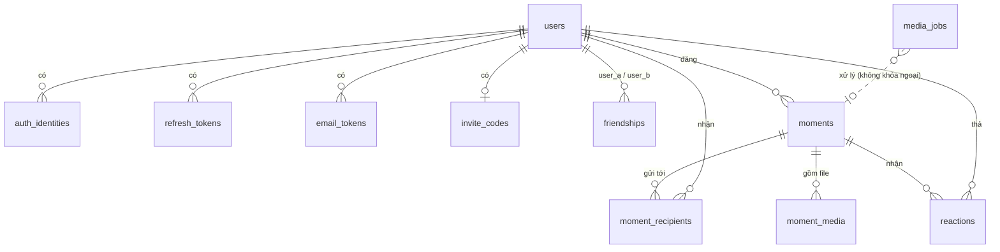
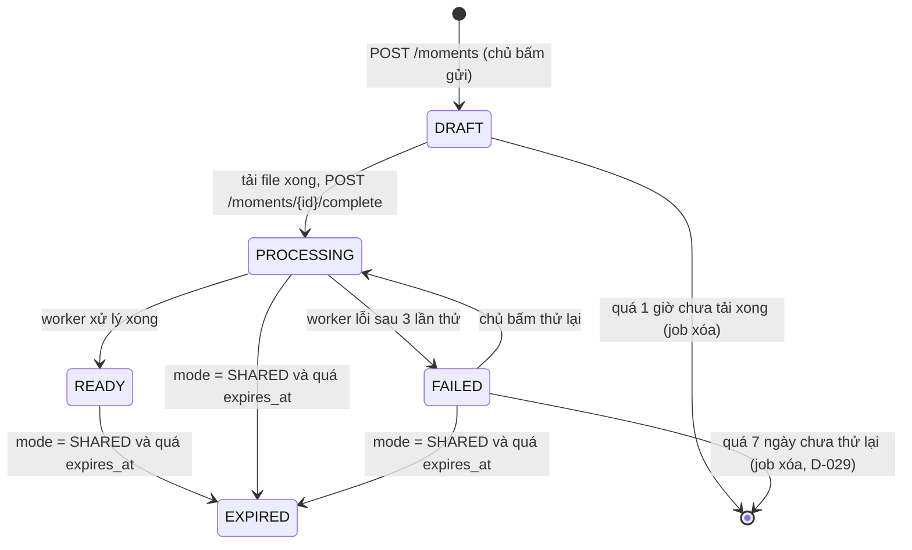

# Thiết kế database

Phiên bản: bản chốt 1 · Cập nhật: 16/11/2026 · Dựa trên: [Đặc tả MVP](../01-san-pham/dac-ta-mvp.md) (mã BR-xx trỏ tới quy tắc nghiệp vụ trong đó)

MVP dùng một cơ sở dữ liệu PostgreSQL 16 với 11 bảng (tính cả hàng đợi `media_jobs`). File ảnh/video nằm trong object storage; database chỉ giữ khóa của file. Hàng đợi xử lý media cũng là một bảng PostgreSQL, nên không cần thêm message broker.

## 1. Sơ đồ quan hệ



## 2. Quy ước chung

- Khóa chính là `uuid` sinh bằng `gen_random_uuid()` (có sẵn từ PostgreSQL 13), riêng `media_jobs` dùng `bigint` tự tăng.
- Thời gian luôn là `timestamptz`, lưu UTC.
- Giá trị liệt kê lưu `varchar` + `CHECK`, không dùng kiểu `enum` của PostgreSQL để thêm giá trị mới chỉ cần sửa `CHECK`.
- Email và username so sánh không phân biệt hoa thường bằng unique index trên `lower(...)`, không cần extension `citext`.
- Token (refresh, xác thực email, đặt lại mật khẩu) chỉ lưu bản băm SHA-256, không lưu token gốc.
- Xóa tài khoản và xóa khoảnh khắc là xóa thật (`ON DELETE CASCADE`); file trong object storage được xóa bất đồng bộ qua `media_jobs`.
- Migration quản lý bằng Flyway, file đầu tiên là `V1__init.sql` (toàn bộ phần 3).

## 3. Định nghĩa bảng

```sql
-- Người dùng
CREATE TABLE users (
    id                uuid PRIMARY KEY DEFAULT gen_random_uuid(),
    email             varchar(254) NOT NULL,
    email_verified_at timestamptz,
    password_hash     varchar(100),              -- NULL nếu chỉ đăng nhập Google
    username          varchar(20),               -- NULL cho tới khi xong bước chọn username (US-06)
    display_name      varchar(40),
    avatar_key        varchar(300),              -- khóa file trong object storage
    locale            varchar(5)  NOT NULL DEFAULT 'vi' CHECK (locale IN ('vi', 'en')),
    plan              varchar(16) NOT NULL DEFAULT 'FREE' CHECK (plan IN ('FREE')),
    is_demo           boolean     NOT NULL DEFAULT false,
    created_at        timestamptz NOT NULL DEFAULT now(),
    updated_at        timestamptz NOT NULL DEFAULT now(),
    CONSTRAINT users_username_format CHECK (username ~ '^[a-z0-9._]{3,20}$')
);
CREATE UNIQUE INDEX users_email_uk    ON users (lower(email));
CREATE UNIQUE INDEX users_username_uk ON users (lower(username));

-- Danh tính đăng nhập bên ngoài (Google)
CREATE TABLE auth_identities (
    id         uuid PRIMARY KEY DEFAULT gen_random_uuid(),
    user_id    uuid NOT NULL REFERENCES users (id) ON DELETE CASCADE,
    provider   varchar(16)  NOT NULL CHECK (provider IN ('GOOGLE')),
    subject    varchar(255) NOT NULL,             -- claim "sub" của Google
    email      varchar(254) NOT NULL,
    created_at timestamptz  NOT NULL DEFAULT now(),
    CONSTRAINT auth_identities_provider_subject_uk UNIQUE (provider, subject)
);
CREATE INDEX auth_identities_user_idx ON auth_identities (user_id);

-- Refresh token, xoay vòng theo "family" để phát hiện token bị dùng lại
CREATE TABLE refresh_tokens (
    id          uuid PRIMARY KEY DEFAULT gen_random_uuid(),
    user_id     uuid NOT NULL REFERENCES users (id) ON DELETE CASCADE,
    family_id   uuid NOT NULL,
    token_hash  char(64)    NOT NULL UNIQUE,      -- SHA-256 hex
    expires_at  timestamptz NOT NULL,
    revoked_at  timestamptz,
    replaced_by uuid,
    user_agent  varchar(255),
    created_at  timestamptz NOT NULL DEFAULT now()
);
CREATE INDEX refresh_tokens_user_idx   ON refresh_tokens (user_id);
CREATE INDEX refresh_tokens_family_idx ON refresh_tokens (family_id);

-- Token gửi qua email: xác thực email, đặt lại mật khẩu
CREATE TABLE email_tokens (
    id         uuid PRIMARY KEY DEFAULT gen_random_uuid(),
    user_id    uuid NOT NULL REFERENCES users (id) ON DELETE CASCADE,
    purpose    varchar(20) NOT NULL CHECK (purpose IN ('VERIFY_EMAIL', 'RESET_PASSWORD')),
    token_hash char(64)    NOT NULL UNIQUE,
    expires_at timestamptz NOT NULL,
    used_at    timestamptz,
    created_at timestamptz NOT NULL DEFAULT now()
);
CREATE INDEX email_tokens_user_idx ON email_tokens (user_id, purpose);

-- Mã mời: đúng một mã đang hoạt động cho mỗi người (BR-04)
CREATE TABLE invite_codes (
    user_id    uuid PRIMARY KEY REFERENCES users (id) ON DELETE CASCADE,
    code       varchar(16) NOT NULL UNIQUE,
    created_at timestamptz NOT NULL DEFAULT now()
);

-- Quan hệ bạn bè: mỗi cặp lưu một dòng, user_a_id < user_b_id
CREATE TABLE friendships (
    user_a_id  uuid NOT NULL REFERENCES users (id) ON DELETE CASCADE,
    user_b_id  uuid NOT NULL REFERENCES users (id) ON DELETE CASCADE,
    created_at timestamptz NOT NULL DEFAULT now(),
    PRIMARY KEY (user_a_id, user_b_id),
    CONSTRAINT friendships_order CHECK (user_a_id < user_b_id)
);
CREATE INDEX friendships_user_b_idx ON friendships (user_b_id);

-- Khoảnh khắc
CREATE TABLE moments (
    id             uuid PRIMARY KEY DEFAULT gen_random_uuid(),
    owner_id       uuid NOT NULL REFERENCES users (id) ON DELETE CASCADE,
    media_type     varchar(8)  NOT NULL CHECK (media_type IN ('PHOTO', 'VIDEO')),
    source         varchar(8)  NOT NULL CHECK (source IN ('CAMERA', 'UPLOAD')),
    mode           varchar(8)  NOT NULL CHECK (mode IN ('SHARED', 'KEPT')),
    audience       varchar(8)  NOT NULL CHECK (audience IN ('ALL', 'SELECTED')),
    status         varchar(12) NOT NULL DEFAULT 'DRAFT'
                   CHECK (status IN ('DRAFT', 'PROCESSING', 'READY', 'FAILED', 'EXPIRED')),
    caption        text,
    layers         jsonb       NOT NULL DEFAULT '[]'::jsonb,   -- lớp trang trí, xem phần 5
    layers_version smallint    NOT NULL DEFAULT 1,
    trim_start_ms  integer     CHECK (trim_start_ms >= 0),     -- chỉ cho video tải lên dài hơn 5 giây
    duration_ms    integer,
    width          integer,
    height         integer,
    failure_reason varchar(200),
    created_at     timestamptz NOT NULL DEFAULT now(),         -- lúc chủ bấm gửi (BR-13)
    expires_at     timestamptz NOT NULL,                       -- created_at + 24 giờ
    kept_at        timestamptz,
    processed_at   timestamptz,
    -- Giới hạn an toàn theo độ dài chuỗi; giới hạn theo grapheme (BR-11) kiểm tra ở tầng ứng dụng
    CONSTRAINT moments_caption_len CHECK (char_length(caption) <= 400),
    CONSTRAINT moments_kept        CHECK ((mode = 'KEPT') = (kept_at IS NOT NULL))
);
CREATE INDEX moments_owner_created_idx ON moments (owner_id, created_at DESC, id DESC);
CREATE INDEX moments_owner_kept_idx    ON moments (owner_id, created_at DESC, id DESC)
    WHERE mode = 'KEPT' AND status = 'READY';
CREATE INDEX moments_shared_expiry_idx ON moments (expires_at)
    WHERE mode = 'SHARED' AND status IN ('PROCESSING', 'READY', 'FAILED');
CREATE INDEX moments_draft_idx         ON moments (created_at) WHERE status = 'DRAFT';

-- Người nhận, chốt tại thời điểm đăng (BR-12); created_at chép từ moments để sắp xếp feed
CREATE TABLE moment_recipients (
    moment_id    uuid NOT NULL REFERENCES moments (id) ON DELETE CASCADE,
    recipient_id uuid NOT NULL REFERENCES users (id) ON DELETE CASCADE,
    created_at   timestamptz NOT NULL,
    PRIMARY KEY (moment_id, recipient_id)
);
CREATE INDEX moment_recipients_feed_idx ON moment_recipients (recipient_id, created_at DESC, moment_id DESC);

-- Các file của một khoảnh khắc
CREATE TABLE moment_media (
    id           uuid PRIMARY KEY DEFAULT gen_random_uuid(),
    moment_id    uuid NOT NULL REFERENCES moments (id) ON DELETE CASCADE,
    variant      varchar(12) NOT NULL CHECK (variant IN ('ORIGINAL', 'COMPOSED', 'DISPLAY', 'VIDEO', 'THUMBNAIL')),
    object_key   varchar(300) NOT NULL UNIQUE,
    content_type varchar(64)  NOT NULL,
    size_bytes   bigint,
    width        integer,
    height       integer,
    duration_ms  integer,
    created_at   timestamptz NOT NULL DEFAULT now(),
    CONSTRAINT moment_media_variant_uk UNIQUE (moment_id, variant)
);

-- Reaction: tối đa một reaction mỗi người trên một khoảnh khắc (BR-21)
CREATE TABLE reactions (
    moment_id  uuid NOT NULL REFERENCES moments (id) ON DELETE CASCADE,
    user_id    uuid NOT NULL REFERENCES users (id) ON DELETE CASCADE,
    emoji      varchar(16) NOT NULL CHECK (emoji IN ('❤️', '😍', '🔥', '😂', '😮', '😢')),  -- server chuẩn hóa trước khi lưu (D-028)
    created_at timestamptz NOT NULL DEFAULT now(),
    updated_at timestamptz NOT NULL DEFAULT now(),
    PRIMARY KEY (moment_id, user_id)
);

-- Hàng đợi việc nền: xử lý media, xóa file
CREATE TABLE media_jobs (
    id         bigint GENERATED ALWAYS AS IDENTITY PRIMARY KEY,
    type       varchar(20) NOT NULL CHECK (type IN ('PROCESS_MOMENT', 'DELETE_OBJECTS')),
    moment_id  uuid,                              -- không khóa ngoại: khoảnh khắc có thể đã bị xóa
    payload    jsonb       NOT NULL DEFAULT '{}'::jsonb,
    status     varchar(10) NOT NULL DEFAULT 'PENDING'
               CHECK (status IN ('PENDING', 'RUNNING', 'DONE', 'FAILED')),
    attempts   smallint    NOT NULL DEFAULT 0,
    run_after  timestamptz NOT NULL DEFAULT now(),
    locked_at  timestamptz,
    last_error text,
    created_at timestamptz NOT NULL DEFAULT now(),
    updated_at timestamptz NOT NULL DEFAULT now()
);
CREATE INDEX media_jobs_pick_idx ON media_jobs (run_after) WHERE status = 'PENDING';
```

## 4. Vòng đời khoảnh khắc



- `mode` đổi từ `SHARED` sang `KEPT` độc lập với `status`, chỉ khi `expires_at > now()` (BR-16). Khoảnh khắc `KEPT` không bao giờ sang `EXPIRED`.
- Xóa khoảnh khắc (BR-18) xóa hẳn dòng `moments` ở mọi trạng thái; các bảng con xóa theo cascade.

## 5. Lớp trang trí (`moments.layers`)

`layers` là một mảng JSON; mỗi phần tử là một lớp. Tọa độ và kích thước tính theo tỉ lệ 0–1 của khung ảnh, nên hiển thị đúng ở mọi kích thước màn hình.

```json
[
  {
    "id": "c1",
    "type": "caption",
    "text": "trời hôm nay đẹp quá trời ơi",
    "x": 0.5, "y": 0.88, "scale": 1, "rotation": 0,
    "style": "pill-dark"
  },
  {
    "id": "s1",
    "type": "sticker",
    "text": "vibe check: 10/10",
    "x": 0.72, "y": 0.4, "scale": 1.1, "rotation": 6,
    "style": "handwritten-yellow"
  },
  {
    "id": "b1",
    "type": "banner",
    "bannerId": "genz-no-cap",
    "x": 0.3, "y": 0.2, "scale": 0.9, "rotation": -4
  }
]
```

- `type`: `caption` (tối đa 1), `sticker` (chữ tự nhập), `banner` (biểu ngữ dựng sẵn, tham chiếu theo `bannerId`).
- `style` và `bannerId` là mã do client định nghĩa; server chỉ kiểm tra là chuỗi ngắn hợp lệ.
- Server kiểm tra: tối đa 20 lớp, tối đa 1 caption, giới hạn ký tự theo BR-11, `x`, `y` trong 0–1, `scale` trong 0.2–5, `rotation` trong −180–180.
- Cột `caption` của bảng `moments` chép lại chữ của lớp `caption` để hiển thị ở các chỗ không vẽ lớp (danh sách, tìm kiếm sau này).
- Đổi cấu trúc JSON thì tăng `layers_version` và viết code chuyển đổi khi đọc.

## 6. File trong object storage

Bucket để riêng tư; client chỉ đọc/ghi qua presigned URL có hạn (ghi 15 phút, đọc 10 phút).

| Biến thể | Ảnh | Video | Ai tạo | Giữ bao lâu |
| --- | --- | --- | --- | --- |
| `ORIGINAL` | Ảnh gốc người dùng tải lên | File gốc người dùng tải lên | Client | Ảnh: giữ cùng khoảnh khắc (để trang trí lại ở giai đoạn 3). Video: xóa sau khi xử lý xong |
| `COMPOSED` | Ảnh đã vẽ lớp trang trí, xuất từ canvas | Không có | Client | Như khoảnh khắc |
| `DISPLAY` | Từ `COMPOSED`, cạnh dài 1440 px | Không có | Worker | Như khoảnh khắc |
| `VIDEO` | Không có | H.264 + AAC, tối đa 720p, đúng 5 giây từ `trim_start_ms` | Worker | Như khoảnh khắc |
| `THUMBNAIL` | Từ `COMPOSED`, cạnh dài 480 px | Khung hình đầu đoạn đã cắt, 480 px | Worker | Như khoảnh khắc |

Với video, client vẽ lớp trang trí đè lên video lúc phát dựa trên `layers`; không ghép lớp vào video.

Worker (T-132, D-033) xuất `DISPLAY` và `THUMBNAIL` dạng JPEG, không phóng to ảnh nhỏ, bỏ metadata (vị trí GPS). Video không có `trim_start_ms` cắt từ đầu; điểm bắt đầu quá gần cuối thì lùi lại để đoạn cắt đủ 5 giây khi video đủ dài. Video gốc dài quá 60 giây (BR-10), file không đọc được theo định dạng khai báo hay lớn hơn 50 megapixel thì khoảnh khắc sang `FAILED` ngay, không thử lại. Kích thước (`width`, `height`, `duration_ms`) của khoảnh khắc lấy từ `DISPLAY` với ảnh, `VIDEO` với video; mỗi dòng `moment_media` do worker tạo cũng ghi kích thước của file đó.

Khóa file: `moments/{momentId}/{variant}-{uuid}.{ext}` và `avatars/{userId}/{uuid}.webp`. Phần `{uuid}` ngẫu nhiên để không ai đoán được khóa.

## 7. Truy vấn chính

**Kiểm tra hai người là bạn**

```sql
SELECT EXISTS (
    SELECT 1 FROM friendships
    WHERE user_a_id = LEAST(:u1, :u2) AND user_b_id = GREATEST(:u1, :u2)
);
```

**Feed (US-30, BR-19):** khoảnh khắc của tôi và khoảnh khắc gửi cho tôi từ người đang là bạn, còn trong 24 giờ, phân trang bằng con trỏ `(created_at, id)`.

```sql
SELECT m.*
FROM moments m
WHERE m.status = 'READY'
  AND m.expires_at > now()
  AND (
        m.owner_id = :me
     OR (
          EXISTS (SELECT 1 FROM moment_recipients r
                  WHERE r.moment_id = m.id AND r.recipient_id = :me)
          AND EXISTS (SELECT 1 FROM friendships f
                      WHERE f.user_a_id = LEAST(m.owner_id, :me)
                        AND f.user_b_id = GREATEST(m.owner_id, :me))
        )
  )
  AND (m.created_at, m.id) < (:cursorCreatedAt, :cursorId)
ORDER BY m.created_at DESC, m.id DESC
LIMIT 20;
```

**Kho "Được gửi" (US-41):**

```sql
SELECT m.*
FROM moment_recipients r
JOIN moments m ON m.id = r.moment_id
WHERE r.recipient_id = :me
  AND m.mode = 'KEPT' AND m.status = 'READY'
  AND EXISTS (SELECT 1 FROM friendships f
              WHERE f.user_a_id = LEAST(m.owner_id, :me)
                AND f.user_b_id = GREATEST(m.owner_id, :me))
  AND (r.created_at, r.moment_id) < (:cursorCreatedAt, :cursorId)
ORDER BY r.created_at DESC, r.moment_id DESC
LIMIT 30;
```

**Chuyển sang lưu giữ (BR-16):** một câu lệnh có điều kiện, nên không đụng độ với job hết hạn.

```sql
UPDATE moments
SET mode = 'KEPT', kept_at = now()
WHERE id = :id AND owner_id = :me
  AND mode = 'SHARED' AND status IN ('PROCESSING', 'READY')
  AND expires_at > now();
-- 0 dòng bị ảnh hưởng → trả lỗi MOMENT_NOT_KEEPABLE
```

**Lấy việc trong hàng đợi (worker):**

```sql
UPDATE media_jobs SET status = 'RUNNING', locked_at = now(), attempts = attempts + 1, updated_at = now()
WHERE id = (
    SELECT id FROM media_jobs
    WHERE status = 'PENDING' AND run_after <= now()
    ORDER BY run_after
    FOR UPDATE SKIP LOCKED
    LIMIT 1
)
RETURNING *;
```

## 8. Ràng buộc kiểm tra ở tầng ứng dụng

Một số quy tắc không biểu diễn gọn bằng ràng buộc SQL, nên service phải kiểm tra trong transaction:

| Quy tắc | Cách kiểm tra |
| --- | --- |
| Tối đa 15 bạn (BR-06) | Trong transaction kết bạn: `SELECT ... FOR UPDATE` hai dòng `users` theo thứ tự id tăng dần, đếm bạn của từng người, rồi mới chèn `friendships`. Khóa theo thứ tự cố định để tránh deadlock |
| Người nhận phải là bạn hiện tại (BR-12) | Khi tạo khoảnh khắc, lọc `recipientIds` theo bảng `friendships`; có id không phải bạn → lỗi |
| Giới hạn theo grapheme (BR-11) | `java.text.BreakIterator.getCharacterInstance()` đếm ký tự hiển thị |
| Không tự thả reaction (BR-23) | So `user_id` với `moments.owner_id` |
| Quyền xem (BR-19) | Một hàm dùng chung `MomentAccessPolicy.canView(viewer, moment)` cho mọi API |

## 9. Job định kỳ

| Job | Chu kỳ | Việc làm |
| --- | --- | --- |
| Hết hạn khoảnh khắc chia sẻ | 5 phút | Chuyển `SHARED` quá `expires_at` sang `EXPIRED`, xóa dòng `moment_media`, tạo việc `DELETE_OBJECTS` với danh sách khóa file |
| Dọn bản nháp | 15 phút | Xóa khoảnh khắc `DRAFT` tạo quá 1 giờ, kèm việc xóa file đã lỡ tải lên |
| Dọn khoảnh khắc lỗi | 1 ngày | Xóa khoảnh khắc `FAILED` tạo quá 7 ngày ở mọi chế độ, kèm việc xóa file (D-029) |
| Dọn token | 1 ngày | Xóa `refresh_tokens` và `email_tokens` đã hết hạn quá 7 ngày |
| Dọn hàng đợi | 1 ngày | Xóa `media_jobs` ở trạng thái `DONE` quá 7 ngày; việc `RUNNING` bị khóa quá 10 phút trả về `PENDING` |

Trong MVP, các job chạy bằng `@Scheduled` trong cùng ứng dụng Spring Boot (chỉ một instance). Nếu sau này chạy nhiều instance thì thêm ShedLock để mỗi job chỉ chạy một nơi.
